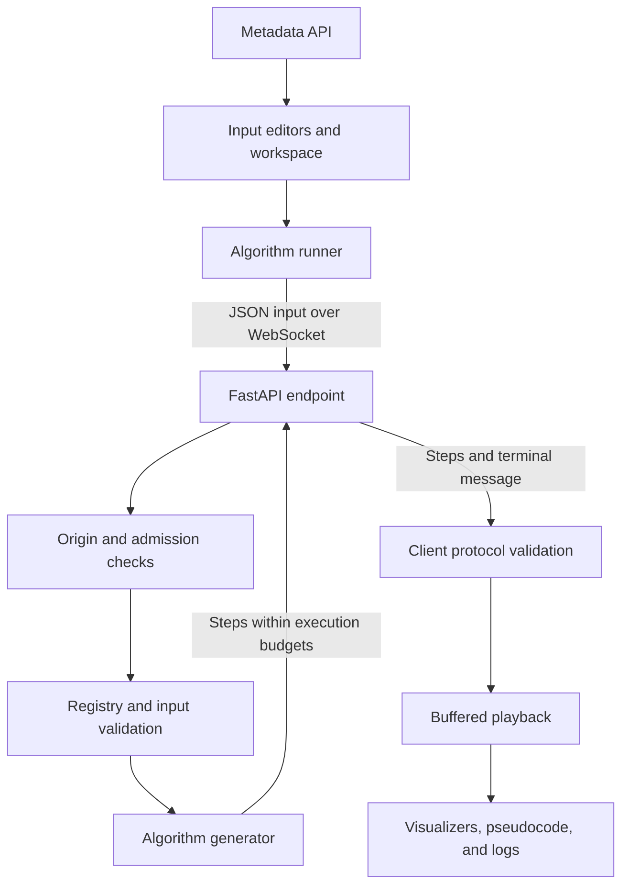

# AlgoVisualizer - Developer Documentation

> Architecture, local setup, protocol contracts, and verification guidance for AlgoVisualizer development.

**Version:** 0.1.0 | **Last Updated:** 2026-08-23

**Scope:** Frontend and backend development, testing, deployment, and maintenance.

## Table of Contents

- [Architecture Overview](#architecture-overview)
- [Technology Stack](#technology-stack)
- [Project Structure](#project-structure)
- [Local Setup](#local-setup)
- [Runtime Flow](#runtime-flow)
- [Workspace and Playback](#workspace-and-playback)
- [HTTP API](#http-api)
- [WebSocket Protocol](#websocket-protocol)
- [Configuration and Work Budgets](#configuration-and-work-budgets)
- [Data Handling and Logging](#data-handling-and-logging)
- [Adding an Algorithm](#adding-an-algorithm)
- [Testing and Verification](#testing-and-verification)
- [Deployment](#deployment)
- [Troubleshooting](#troubleshooting)
- [Maintenance Notes](#maintenance-notes)

## Architecture Overview

The React frontend loads algorithm metadata from FastAPI and receives execution steps over one WebSocket per run. Python algorithms are synchronous generators. The endpoint validates input and bounds execution, while the frontend validates incoming frames and manages playback independently of reception.



| Decision | Purpose |
| --- | --- |
| Decorator-based registry | Keep metadata and implementation together; expose registered algorithms through the API. |
| One socket per execution | Give each run explicit completion, error, and cancellation boundaries. |
| Independent snapshots | Preserve earlier steps when an algorithm mutates its working data. |
| Bounded streaming and playback | Limit input, generated work, retained frames, and memory use. |
| Separate editor drafts | Preserve array, grid, and graph inputs when changing views. |

## Technology Stack

| Area | Technology |
| --- | --- |
| Frontend | React 19, TypeScript 5.9, React Router 7 |
| Styling and icons | Tailwind CSS 4, Lucide, clsx, tailwind-merge |
| Frontend tooling | Vite 8, ESLint 9, npm |
| Backend | Python 3.11+, FastAPI, Uvicorn, websockets, uv |
| Transport | HTTP metadata and protocol version 2 WebSocket messages |
| Tests | pytest, pytest-asyncio, Vitest 5, Testing Library, Playwright |

Dependency declarations live in `frontend/package.json` and `backend/pyproject.toml`. Their lockfiles record resolved versions; Python deployment requirements are exported from `backend/uv.lock`.

## Project Structure

```text
algorithm-visualizer/
├── api/index.py                 # FastAPI entry point for Vercel
├── backend/
│   ├── app/
│   │   ├── main.py              # HTTP routes and WebSocket lifecycle
│   │   ├── config.py            # Origin policy and resource limits
│   │   ├── admission.py         # Per-worker connection and rate budgets
│   │   ├── validation.py        # Array, grid, and graph schemas
│   │   ├── observability.py     # Structured execution logs
│   │   ├── registry.py          # Algorithm registration and lookup
│   │   ├── base_algorithm.py    # Shared generator contract
│   │   └── algorithms/         # Sorting and pathfinding implementations
│   ├── tests/                  # Algorithm, validation, and socket tests
│   ├── pyproject.toml
│   ├── requirements.txt
│   └── uv.lock
├── frontend/
│   ├── e2e/                    # Browser regressions
│   ├── public/                 # Public assets
│   ├── src/
│   │   ├── components/         # Inputs, visualizers, workspace, shared UI
│   │   ├── contexts/           # Algorithm metadata loading
│   │   ├── hooks/              # Execution, workspace state, and playback
│   │   ├── lib/                # URL, input, graph, and protocol helpers
│   │   ├── pages/              # Home and algorithm workspace routes
│   │   ├── test/               # Shared unit-test setup
│   │   └── types/              # Input and execution contracts
│   ├── package.json
│   └── package-lock.json
├── assets/                     # Screenshots and branding
├── .env.example                # Backend configuration example
├── vercel.json                 # Frontend build and API/socket rewrites
├── requirements.txt            # Python requirements for root deployment
├── CHANGELOG.md                # Version history and unreleased changes
├── DEVELOPMENT.md              # Developer guide
├── LICENSE.md                  # License terms
├── TASKS.md                    # Unfinished work
└── README.md                   # Product overview
```

## Local Setup

### Requirements

- Python 3.11 or newer and uv.
- Node.js matching `^22.12.0 || ^24.0.0 || >=26.0.0`, as declared in `frontend/package.json`, and npm. Node 23 and 25 are outside this range.

Clone the repository:

```bash
git clone https://github.com/qtremors/algorithm-visualizer.git
cd algorithm-visualizer
```

Run the backend in one terminal, starting from the repository root:

```bash
uv sync --project backend --frozen
uv run --project backend uvicorn app.main:api --app-dir backend --reload --ws-max-size 65536
```

Run the frontend in a second terminal, also starting from the repository root:

```bash
cd frontend
npm ci
npm run dev
```

Open [http://localhost:5173](http://localhost:5173). The development frontend connects to `http://127.0.0.1:8000` by default. Optional environment files are described under [Configuration and Work Budgets](#configuration-and-work-budgets).

## Runtime Flow

1. The metadata context requests `/api/algorithms`, with a visible retry action on failure and a 60-second request timeout.
2. The user selects an algorithm and edits or generates its input.
3. The runner opens `/ws/visualize/{category}/{algorithm_name}` and sends one JSON text input.
4. The backend checks the origin and admission budgets, looks up the registered algorithm, validates its input, and streams generated steps within frame, byte, and time limits.
5. The frontend validates incoming messages and publishes batches to playback while reception continues.
6. The backend sends a terminal completion or error message. The client checks the final step count and connection outcome.
7. Reset or workspace cleanup closes the active socket and prevents stale events from reviving the run.

## Workspace and Playback

Each workspace keeps separate array, grid, and graph drafts. Changing category remounts the workspace and cleans up its socket. Changing algorithm or view clears incompatible playback while preserving drafts. Editor controls are disabled during execution or playback; Reset cancels an active run.

Playback supports pause, forward and backward steps, and a 10-500 ms step interval. It can wait for incoming steps without resetting the playhead. Native dialogs provide focus containment, an inert background, Escape dismissal, and focus restoration.

Graph positions use one stable SVG coordinate space. Pointer positions pass through its inverse screen transform; connections use pointer capture and cancellation. Symmetric equal-weight adjacency is rendered once as an undirected edge; asymmetric edges retain arrows. Only consecutive returned path edges are highlighted. Keyboard actions support grid editing, graph node creation, connections, and weight editing.

## HTTP API

| Endpoint | Response |
| --- | --- |
| `GET /api/health` | `{"status":"ok","protocol":2}` after algorithm imports. |
| `GET /api/algorithms` | Category keys containing algorithm keys and their metadata. |

Metadata includes name, pseudocode, input type, visualizer, description, complexity, advantages, and disadvantages. Registered modules must be imported by `backend/app/main.py` for their decorators to run.

## WebSocket Protocol

Protocol version 2 uses `/ws/visualize/{category}/{algorithm_name}`. Send one JSON text input per connection.

### Inputs

Sorting:

```json
[3, -2, 0, 1]
```

Grid pathfinding:

```json
{"kind":"grid","grid":[[0,0],[1,0]],"start":{"row":0,"col":0},"end":{"row":1,"col":1}}
```

Graph pathfinding:

```json
{"kind":"graph","nodes":{"A":{"x":100,"y":100},"B":{"x":300,"y":100}},"adjacency":{"A":{"B":0},"B":{"A":0}},"start":"A","end":"B"}
```

The backend also accepts legacy inputs without `kind`, inferring it from grid/adjacency. Graph API consumers may omit positions, in which case adjacency keys define the vertices. Every vertex, including an isolated one, needs an adjacency object. Endpoint IDs must exist. IDs use 1-64 letters, numbers, underscores, or hyphens; JavaScript prototype keys are rejected.

### Steps and Terminal Messages

Steps have `type`, `payload`, `snapshot`, `message`, and a one-based `line`. Step types are `info`, `compare`, `swap`, `sorted`, `visit_node`, `relax_edge`, and `found_path`. Payload fields include `indices`, `node`, `from`, `to`, `dist`, and `path`, depending on the step. Sorting snapshots are stable integer arrays. Grid/graph snapshots contain `type`, `visited`, and `path`; static grid geometry is held by the client and omitted on the wire.

Successful exhaustion sends `{"type":"complete","steps":N}` and closes with code 1000. A search that finds no path still completes successfully.

Execution errors send `{"type":"error","code":"invalid_input","message":"..."}` and an appropriate close code. Error codes include `invalid_input`, `limit_exceeded`, `timeout`, and `execution_failed`. Origin and admission failures can reject the connection before it is accepted, without a terminal JSON message.

A normal close without completion, a mismatched step count, malformed data, or an abnormal close fails the run even if partial steps arrived. Reset/unmount detaches callbacks and closes the socket.

## Configuration and Work Budgets

### Environment Files and Backend URLs

Backend settings are listed in [`.env.example`](.env.example). Export them in the service environment or copy the example to root `.env` and add `--env-file .env` to the root backend startup command. Uvicorn does not load that file automatically.

For frontend configuration, copy [`frontend/.env.example`](frontend/.env.example) to `frontend/.env.local`. Vite reads it at startup/build time. Never put secrets in `VITE_` variables because their values are compiled into browser code.

`VITE_API_BASE_URL` accepts an HTTP(S) base URL or a host with an optional port. Development defaults to `http://127.0.0.1:8000`; production defaults to the page's origin. The URL helper derives `ws:` from HTTP and `wss:` from HTTPS for visualization connections. An HTTPS page requires an HTTPS/WSS backend.

`ALLOWED_ORIGINS` is a comma-separated list of complete origins, including scheme and optional port. Values are trimmed. Missing/empty configuration defaults to public `*`; explicit lists restrict HTTP CORS and WebSocket handshakes. Credentials are disabled because the app has no account/cookie authentication. Work limits apply independently of CORS.

### Default Limits

| Setting | Default |
| --- | --- |
| `MAX_ARRAY_SIZE` | 100 |
| `MAX_GRID_ROWS`, `MAX_GRID_COLS` | 50 each |
| `MAX_GRAPH_NODES`, `MAX_GRAPH_EDGES` | 50 vertices, 500 directed adjacency entries |
| `MAX_INPUT_BYTES` | 65,536 |
| `MAX_STEPS` | 12,000 |
| `MAX_TRACE_BYTES` | 16 MiB |
| `INPUT_TIMEOUT_SECONDS` | 5 |
| `EXECUTION_TIMEOUT_SECONDS` | 10 |
| `MAX_CONNECTIONS`, `MAX_CONNECTIONS_PER_IP` | 8 total, 2 per address |
| `CONNECTIONS_PER_MINUTE` | 20 per address |

These settings must be positive integers. Concurrency and rate budgets are per ASGI worker, and the rate cache is bounded to 1,024 addresses. Multi-worker or multi-instance deployments need aggregate quotas at their gateway. The startup command sets a transport message limit; the application independently validates received byte length.

Large valid inputs can exceed trace or time budgets and return an error asking for a smaller input. Frontend defaults mirror the input caps and independently bound retained frames/bytes. Raising server caps does not raise frontend caps.

### Input Rules and Algorithm Semantics

- Arrays contain safe integers; booleans and decimals are rejected. An empty array is valid for the backend, although the UI requires input.
- Grids are nonempty and rectangular, with integer endpoints inside non-wall cells. Cells use 0 for open space, 1 for walls, and 5 for an entry cost of 5.
- Graph weights are finite numbers from 0 to 1,000,000.
- BFS optimizes hop count. DFS finds a reachable path without an optimality guarantee. Dijkstra optimizes nonnegative total cost.

## Data Handling and Logging

The browser sends the selected array, grid, or graph to the configured backend for execution. The application has no account system or database. Per-worker admission control temporarily tracks client addresses to enforce connection and rate limits.

Structured execution events record run IDs, step and byte counts, elapsed time, and failure information. Failure events can include category, algorithm, and exception details. The structured logger does not explicitly record input payloads; hosting and server access logs have their own behavior and retention settings. Review those settings before making public privacy or retention claims.

## Adding an Algorithm

1. Subclass `BaseAlgorithm` or `BasePathfindingAlgorithm`. Supply full metadata and use the appropriate validator before yielding steps.
2. Decorate the class with a category and key, such as `@registry.register("sorting", "new_sort")`.
3. Import its module in `backend/app/main.py` so registration executes.
4. Yield stable snapshots and one-based pseudocode line numbers. The endpoint owns terminal messages and work budgets.
5. Add final-result, intermediate-snapshot, invalid-input, and relevant reference checks. New input or visualizer contracts also require updates to frontend types and runtime validation.

The frontend discovers registered metadata automatically. Existing sorting, grid, and graph visualizers can be reused when their contracts match.

## Testing and Verification

Run backend tests from the repository root:

```bash
uv run --project backend pytest backend/tests
```

Run frontend checks from a separate terminal at the repository root:

```bash
cd frontend
npm run lint
npm test -- --run
npm run build
npm audit
```

For browser regressions, run these commands from `frontend`:

```bash
npx playwright install chromium
npm run test:e2e
```

Playwright uses one worker and starts both servers unless reusable development servers are already running. Set `PLAYWRIGHT_CHROMIUM_EXECUTABLE` to an installed Chromium executable's absolute path to use it instead of the downloaded browser.

| Suite | Coverage |
| --- | --- |
| Backend | Sorting and pathfinding results, reference comparisons, validation, stable snapshots, origins, admission, and terminal/error/budget paths. |
| Frontend unit | Input/protocol boundaries, streaming, failure, completion, cancellation, playback scheduling, signed bars, and edge semantics. |
| Browser | Complete user flows, editor interactions, and native dialog focus behavior. |

### Historical Verification

The October 17, 2026 review recorded 96 passing backend tests, 49 frontend unit tests, and 17 Chromium browser regressions, with lint and the production build passing. It also recorded no reported npm vulnerabilities, Python lock consistency, and a passing whitespace check. These are historical results, not checks rerun for this documentation update; audit results change with the advisory database.

That review covered desktop Chromium, including a tall viewport. Firefox, Safari, physical mobile devices, production routing/TLS, and sustained or distributed load were not verified. This guide describes local checks; remote CI execution is outside its scope.

## Deployment

Deploy the frontend and backend together: protocol version 2 clients require explicit terminal messages that older backends do not send. The README links to the existing Netlify demo; the Vercel configuration is a separate deployment option and does not establish which code is running at that demo.

### Vercel Configuration

`vercel.json` builds the Vite frontend and routes `/api/*` and `/ws/*` to `api/index.py`, which exposes the FastAPI instance. Other routes fall back to `index.html`. The configured function duration is 60 seconds.

Vercel documents [native WebSocket support, including FastAPI/ASGI](https://vercel.com/docs/functions/websockets). Configure the deployment's allowed origins and service limits, then verify an actual deployed handshake, terminal completion, and SPA route refresh. Local checks do not confirm deployed routing. Track that remaining verification in [TASKS.md](TASKS.md#deployment-verification).

### Separate Frontend and Backend Hosts

Install `backend/requirements.txt` on the backend host. From the repository root, start Uvicorn with `--app-dir backend`, `--host 0.0.0.0`, the host's assigned port, and the transport limit. For example, if the assigned port is 8000:

```bash
uvicorn app.main:api --app-dir backend --host 0.0.0.0 --port 8000 --ws-max-size 65536
```

Set `VITE_API_BASE_URL` to the backend's HTTPS base URL before building the frontend. Set backend `ALLOWED_ORIGINS` to the frontend's complete origin. Production defaults only work without an explicit backend URL when the frontend host routes both API and socket paths to the backend.

## Troubleshooting

| Symptom | Check |
| --- | --- |
| Cannot import `app.main` | Run the documented command from the repository root with `--app-dir backend`, or run from `backend` without that flag. |
| Metadata fails to load | Check backend `/api/health`, the configured API base URL, allowed origins, and browser network errors; then use Retry. |
| Metadata loads but visualization fails | Check the WebSocket upgrade route, HTTPS/WSS pairing, origin policy, and connection limits. |
| Input or trace limit error | Reduce input size. Server and frontend limits are enforced independently. |
| Run stops after partial output | Inspect the terminal error and backend logs. Partial frames do not establish successful completion. |
| Environment changes have no effect | Restart the backend after exporting settings. Restart Vite or rebuild production assets after changing frontend variables. |
| Node/tooling compatibility errors | Compare `node --version` with the declared engine range, then install from the lockfile with `npm ci`. |
| Playwright cannot launch Chromium | Install it with the documented command or set the executable-path environment variable. |

## Maintenance Notes

- Keep frontend and backend versions aligned. Documentation changes do not require a version bump.
- Keep the frontend lockfile and supported Node engine together when upgrading tooling.
- Preserve protocol compatibility or update both sides and their regression coverage together.
- Run focused checks for the changed behavior; run the relevant full suites before a release.
- Keep [README.md](README.md) focused on the product, [CHANGELOG.md](CHANGELOG.md) on completed changes, and [TASKS.md](TASKS.md) on unfinished work.

After intentional Python lock updates, regenerate the pinned deployment requirements from the repository root:

```bash
uv export --project backend --frozen --no-dev --no-hashes --no-emit-project --output-file backend/requirements.txt
```

Copy the exported file to root `requirements.txt` as well. On PowerShell:

```powershell
Copy-Item backend/requirements.txt requirements.txt
```

On a POSIX shell:

```bash
cp backend/requirements.txt requirements.txt
```
