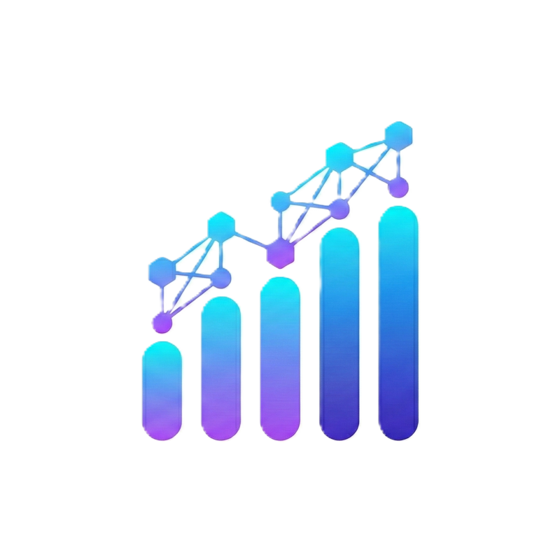
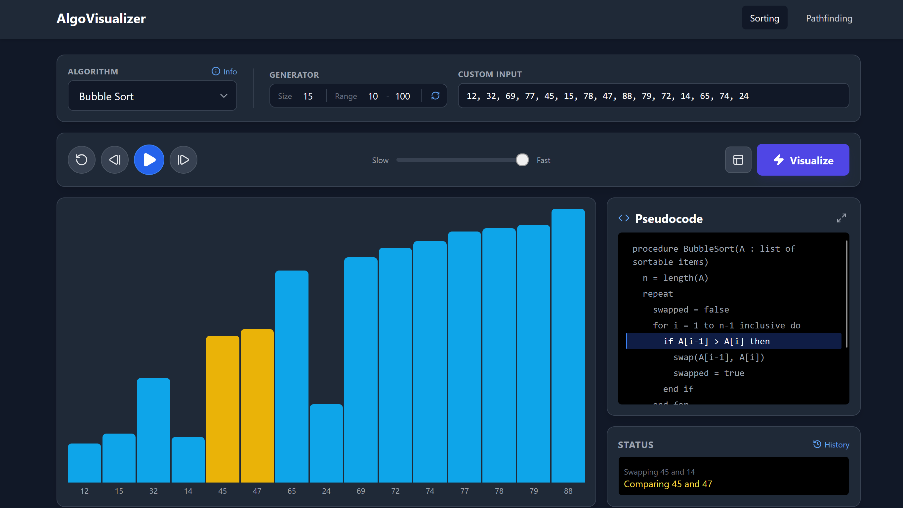
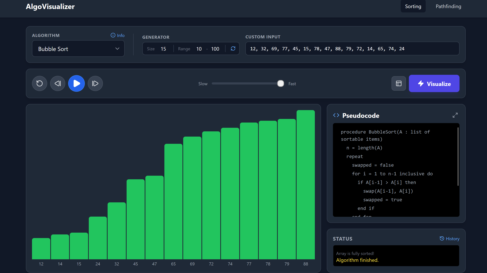
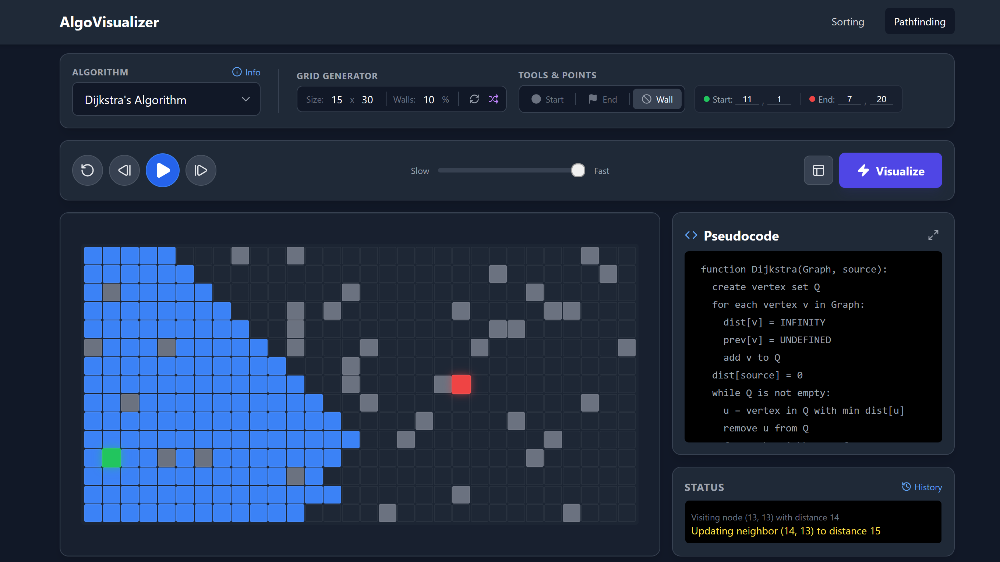
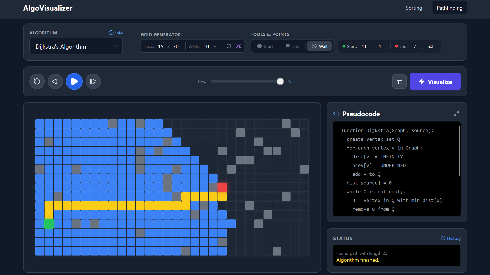

  

<h1 align="center"><a href="https://algoviz-qt.vercel.app/">AlgoVisualizer</a></h1>

  Explore sorting and pathfinding algorithms step by step.

  
  
  
  
  

## Why AlgoVisualizer

AlgoVisualizer is a personal project for learning how algorithms work by implementing them from scratch and watching each step. Edit the input, follow comparisons and visited nodes, and replay the result at your own pace.

## Live website

Open [AlgoVisualizer](https://algoviz-qt.vercel.app/) in your browser. The backend may take a few seconds to wake up on the first visit.

> [!NOTE]
> **Desktop recommended:** The grid and graph editors work best on a larger screen. Keyboard editing is available; mobile support is limited.

## Features

- **Sorting:** Explore Bubble Sort, Selection Sort, and Insertion Sort with animated bars and highlighted comparisons.
- **Pathfinding:** Run BFS, DFS, and Dijkstra on editable grids and network graphs. Compare reachability, hop counts, and weighted paths.
- **Custom inputs:** Enter or generate arrays, draw grid walls and weighted cells, and edit graph nodes and connections.
- **Playback:** Pause, adjust speed, step forward or backward, and reset a visualization.
- **Pseudocode and logs:** Follow the current pseudocode line and review the execution history as steps arrive from the backend.
- **Algorithm explanations:** Read time and space complexity, advantages, and limitations for each algorithm.
- **Keyboard controls:** Use playback shortcuts and keyboard actions for grid and graph editing.

## Screenshots

  
  

  
  

## Community and support

- Report bugs or request features through [GitHub Issues](https://github.com/qtremors/algorithm-visualizer/issues).
- Review changes in the [changelog](CHANGELOG.md).
- See planned work in the [task backlog](TASKS.md).

## Credits

AlgoVisualizer is built by [Tremors](https://github.com/qtremors). Thanks to the maintainers of:

- [React](https://react.dev/), [React Router](https://reactrouter.com/), and [TypeScript](https://www.typescriptlang.org/)
- [Vite](https://vite.dev/), [Tailwind CSS](https://tailwindcss.com/), and [Lucide](https://lucide.dev/)
- [FastAPI](https://fastapi.tiangolo.com/), [Uvicorn](https://www.uvicorn.org/), and [websockets](https://websockets.readthedocs.io/)
- [Vitest](https://vitest.dev/), [Testing Library](https://testing-library.com/), [Playwright](https://playwright.dev/), and [pytest](https://docs.pytest.org/)

Each dependency remains the property of its respective authors and is used under its own license.

## For developers

Architecture, project structure, requirements, local setup, protocol details, testing, and deployment guidance live in [DEVELOPMENT.md](DEVELOPMENT.md).

## License

AlgoVisualizer is source-available under the **Tremors Source License (TSL)**. Viewing, forking, and derivative works require attribution; commercial use requires written permission.

Read [LICENSE.md](LICENSE.md) for the full terms.

---

  Made by <a href="https://github.com/qtremors">Tremors</a>

